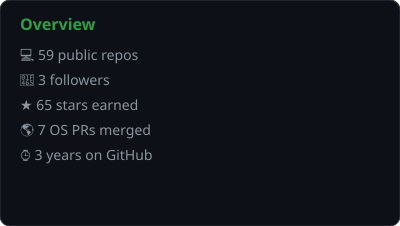
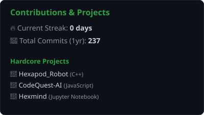
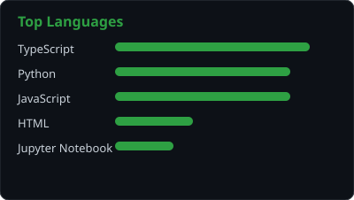
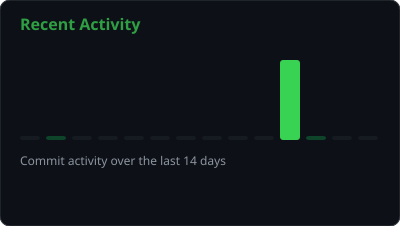

# Hi, I'm Divyanshu

Software engineer who likes hard bugs. I build AI agents and full-stack products, and I spend a lot of time on the question of how you check whether an AI coding agent actually reasoned through a problem or just pattern-matched its way to something that looks right.

Right now I'm an Analyst at Turing, evaluating LLM responses. Before that I was an AI Fellow at Handshake AI, designing evaluation tasks for AI coding agents.

I also come from hardware (B.Tech in ECE, 2026). My capstone, **HexMind**, is a 25-DOF hexapod robot with real-time inverse kinematics, a YOLOv8 vision pipeline and an MCP-based AI co-pilot you can talk to in plain English. It won Best Paper at NCETST-2026 and I demoed it at Anthropic's Built with Claude Hackathon. When a bug on a robot means a power sag resets the board or the IK solver ignores a joint limit, the machine falls over. Working through that taught me to ask early whether a failure is a math problem, a timing problem or a physical one, because from the outside they all look the same.

- **Turing** (current) — Analyst, evaluating LLM responses
- **Infosys Springboard** — built Java full-stack modules end to end (Spring Boot, Hibernate)
- **CertifyO** — full-stack intern, shipped features on a live Node.js/MongoDB platform with Redis caching
- **Handshake AI** — AI Fellow, designed evaluation tasks for AI coding agents

600+ LeetCode problems solved, mostly in Java.

Currently open to remote software and AI engineering roles.

---

## Things I've built

| Project | What it is | Stack |
|---|---|---|
| [HexMind](https://github.com/Divyanshu-2907/Hexmind) | Agentic firmware co-pilot for a 25-DOF hexapod robot. Best Paper, NCETST-2026 | C/C++, Python, YOLOv8, MCP, Claude API |
| [AgentGuard](https://github.com/Divyanshu-2907/AgentGuard) | 11-stage check pipeline that a coding agent's patch has to pass before it runs: sandboxed tests, static analysis, secrets scan, LLM intent match, policy veto | Docker, Node.js, LLM judge |
| [FreeAstrologyAI.com](https://freeastrologyai.com) | Production web app I built and shipped solo in about 3 weeks. 10K+ monthly pageviews | Astro, Cloudflare Workers, Supabase, Gemini |
| [govault](https://github.com/Divyanshu-2907/Govault) | Encrypted secrets manager with a CLI and HTTP API. Caught a real concurrency bug with `go test -race`, 89% coverage | Go |
| [CodeQuest AI](https://github.com/Divyanshu-2907/CodeQuest-AI) | Coding practice platform with sandboxed code execution and AI grading | Next.js, Prisma, E2B, Claude API |
| [Codex Copilot](https://github.com/Divyanshu-2907/Codex-Copilot) | RAG chat agent grounded in a team's engineering standards docs, with per-session memory | Cloudflare Workers AI, Durable Objects |
| [Road Hazard Detection](https://github.com/Divyanshu-2907/Road_Hazard_Detection) | Detects potholes and road hazards from a phone camera | YOLOv8, FastAPI, React Native |

---

## Tech stack

---

## GitHub stats

  
  

  
  

Self-hosted and updated daily by a GitHub Actions workflow (<code>.github/workflows/update-stats.yml</code>).
